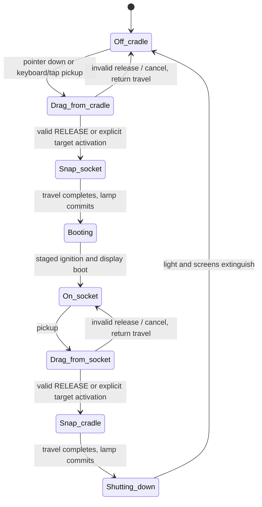
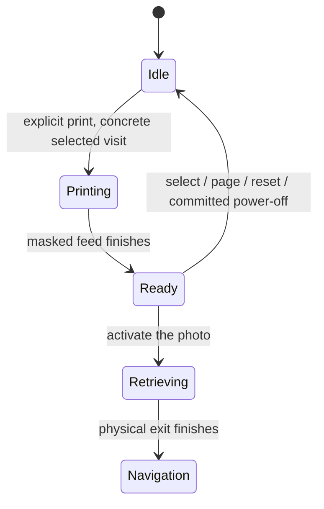

# Playable Memory Archive · 6 November 2026

Implementation of the supplied [instructions](../codex_instruction/vending-machine/CODEX-INSTRUCTIONS-vending-machine-interactive.md), compared with the [original visual reference](../codex_instruction/vending-machine/reference/vending-machine-original-reference.png). The approved cinematic cabinet, photography, public navigation and editorial homepage sections are retained. No dependencies, migrations, owner data writes or new public routes are required.

## Runtime and data contract

`VendingMachine::page()` queries `Visit::publishedVisible()` with place and ready image variants, ordered by visited date then ID. Each server page contains at most six distinct visits; the final page has honest empty windows. No duplicated filler, hardcoded demo count, fabricated photography or random category-to-visit conversion. A missing cover falls back to another ready photo from that same visit, then to an intentional text treatment. Media URLs and detail routes still enforce current visibility.

The existing `/` route handles `X-Vending-Fragment: 1` with a clamped `machine_page`. It returns only slot/preview/print templates and page metadata, `no-store` and `noindex`. The shell and hardware stay mounted. These local interactions do not change the homepage URL or Explore's query/history. Existing collection clients retain `X-Archive-Fragment` and the matching published-only Explore service; legacy random-memory endpoints remain available independently.

`resources/js/components/vending-state.mjs` is the pure state reducer and geometry/angle helpers. `pages/archive.js` coordinates input, rendering, cancellation, fragments, persistence and print snapshots. `components/vending-input.js` owns dial input. Event listeners belong to one abortable lifecycle; initialization disposes a prior lifecycle. Page hide aborts requests/animations; a restored back-forward page initializes again. There is no inline script/data JSON or inline Blade styling. The tiny external `public/assets/vending/session.js` reads session state before first paint, within the existing CSP.

## Power and lamp states

Hovering/holding within the magnetic zone only previews alignment. Power changes after valid release and completed travel. Failed removal never powers down. The ellipse expands the target to 1.8× its physical dimensions, with 40/42px minimum radii; all acceptance uses the **tube centre**, preserving the user's grip offset. Measurements use the tube's actual offset parent, including the compact hardware panel border. Pointer frames use cached geometry and one requestAnimationFrame write. Resize/scroll, Escape, pointercancel, lost capture, secondary pointers and visibility interruptions cannot strand the lamp. Resize finishes current travel and recomputes the committed pose.

`foodie.vending.power` stores on/off in sessionStorage; `foodie.vending.discovered` suppresses the hint after successful installation. No personal journal information is stored. Storage failures fall back to in-memory play. A saved on-state paints the lit cabinet directly without replaying ignition. Valid removal stores off. A never-discovered, idle, non-reduced-motion session gets one unobtrusive hint after 7.2 seconds; any lamp interaction dismisses it.

## Control mapping

| Physical part | Action and fallback |
| --- | --- |
| Glass tube | Drag from the front-left cradle into the vertical socket; reverse the operation to power down. Or tap/click the tube, then its target. Keyboard Enter/Space picks up and focuses the target; Enter confirms; Escape cancels. |
| Upper knurled dial | Angular dragging, continuous delta normalization across ±180°, 32° detents and a real rotating marker. Both directions wrap over actual pages. Left/right click halves, arrow keys and explicit arrow buttons provide alternatives. Wheel is consumed only when the enabled dial has focus; normal page scrolling is unaffected. |
| Lower reset push-button | Depresses 3px and scales slightly on press, then returns; never rotates. Restores the first page/default selection and clears ready paper, preserving power. Native Enter/Space work. |
| Six windows | Select a concrete visit and update the matching preview. With JS disabled these remain ordinary visit-detail links. Modified clicks retain native navigation. |
| Pilih koleksi | Cycles the concrete selection within the current page; the accessible name explicitly says “kunjungan berikutnya”. |
| Ambil memori | Prints the exact selected visit once. Disabled without a visit or while paper is already ready. Choose another visit or reset to prepare another print. |
| Baca cerita | Opens the selected published visit. The screen itself is the same semantic link. |
| Exposed photo | Click or Enter retrieves it with a short physical exit, then opens its actual visit route. Modified clicks retain the real URL. |

All machine actions are disabled/inert while off, except the tube and its placement target. Boot/shutdown and print/retrieval prevent competing input. Page navigation can supersede a pending page request; AbortController plus generation checks discard obsolete fragments. Errors retain the committed page/selection and offer a visible retry. The empty/single-page dial is disabled. Standard header/footer navigation, recent visits, personal picks and Explore remain accessible independently of the game.

## Printing and synchronization

The print template is cloned from the selected slot before travel. Its ID, photograph, place/date and link are one immutable snapshot. The paper feeds from above a clipped path, passes behind the roller and emerges in front of the lower lip. Only one sheet exists. During printing/retrieval, selection, paging, reset and lamp pickup are locked. New selection, page request, reset or power-off retracts a ready sheet. Compact layouts reserve space below the tray so a photo cannot cover the preview. No modal or fabricated destination is involved.

## Artwork and geometry

The supplied screenshot is a proportion/material reference, never a page-sized interactive background. `resources/artwork/archive-cabinet-v2.png` and its existing optimized `cabinet-v2.webp` stay unchanged. The existing independent live windows, right display and tray still cover their genuine apertures. The left instrument panel is deliberately rebuilt as an opaque textured **clean rail**, covering the complete obsolete illuminated lamp/control strip rather than placing controls over old silhouettes or blurred patches.

`tools/build-vending-assets.mjs` produces seven local SVG parts in `public/assets/vending/`. It embeds the project's existing bronze texture into the rail; other materials use hand-authored bevels, reflectors, knurled segments, engraved screws and restrained brush patterns. No generated photo substitutes for actual visit photography. Source and edit instructions: [hardware artwork](../resources/artwork/vending-hardware.md).

| Layer | Source canvas / anchor |
| --- | --- |
| Rail | 140×840, aligned to the old left instrument strip; no motion |
| Socket | 66×280; centre of its live button is the vertical tube anchor |
| Tube | 42×238, independent caps/glass/internal wire/reflection; transform origin 50% 50%; live emission is a separate opacity layer |
| Cradle | 260×80, two brass retainers over a recessed padded bed; centre is the resting anchor, tube rotation −96° (slight diagonal) |
| Rotary | 100×100, 60 knurled segments, ivory marker; transform origin 50% 50% |
| Reset | Separate 100×100 casing and face; only face translates/scales on press |
| Photo / roller | Semantic HTML paper frame containing actual local/private media derivative; origin centre top, clipped feed and independent foreground roller |

Native cabinet geometry remains 1634×963. Existing `config/archive.php` and compiled `archive-geometry.css` own display apertures and slots. New hardware geometry and component material/motion tokens live centrally in `vending-machine.css`; do not alter the source raster to reposition an interactive part. LEDs remain at source centres (1012,267), (1012,405), (1012,546), with 1:1 lenses independent of captions. SVG dimensions and image dimensions reserve stable layout; the immutable SVGs total 28,374 bytes before HTTP compression.

## Motion, responsive design and accessibility

| Motion | Value |
| --- | --- |
| Lift / magnetic guide | 130ms / 120ms |
| Release snap | `--vending-snap`: 270ms, cubic-bezier(.2,.72,.22,1), stable stop |
| Latch | 125ms local metal compression |
| Boot | `--vending-boot`: 960ms; two brief tube ignitions, local warm metal spill, sequential LEDs, left display then right preview |
| Power down | `--vending-off`: 240ms |
| Page cassette movement | 175–235ms, short directional travel |
| Reset depression / return | 85ms / 150ms |
| Photo feed / retrieval | `--vending-print`: 820ms / 180ms |

Only local transform/opacity layers animate; no moving giant background or animated blur. The cabinet's inherited drop-shadow now belongs to the static shell alone, preventing large filtered-surface repaints as paper moves. The duration parser accepts both authored `ms` and Vite-minified `s`; compiled-asset browser tests assert real 270/960/820ms timings. The single cradle glint is short and delayed; powered light then stays steady. `prefers-reduced-motion`, including changes at runtime, skips travel and finishes active work without corrupting state. Visibility interruption finishes bounded active stages and cancels a pending gesture. will-change exists only during drag/snap/print.

At ≥960px the approved wide composition remains. Below 960px the hardware panel keeps socket/cradle within a short touch gesture, with readable physical knobs and arrows. The six windows use a real two-column grid, followed by tactile LED controls, recessed tray and full-width preview. Explicit focus rings, semantic buttons/links, live status, disabled/inert states and image fallbacks cover mouse, touch, keyboard and assistive navigation. Primary touch controls are ≥44px; desktop engraved page arrows are 24px with spacing. Caption and fallback content remains meaningful without motion or photography.

## Verification and remaining limits

Current command results, captured screenshots and performance evidence are recorded in `docs/qa/vending-machine/verification.md` and `evidence.json`. Use the existing isolated servers: 8011 for functional QA, 8012 for bundled, explicitly labeled fictional demo photography. Never refresh the owner's database. Regenerate vectors with `node tools/build-vending-assets.mjs`, then run `npm run build`.

This is layered 2D illustration, not a 3D simulation. Desktop preserves the raster's established perspective; compact devices intentionally recompose the hardware. Audio was optional and is omitted. Chromium emulated touch and automated accessibility checks do not replace physical iOS/Safari, pen hardware or screen-reader UAT. Lab paint/frame measurements are local samples, not production field Core Web Vitals. Content published after the page loaded appears on the next page fetch/reload; normal detail/media requests enforce revocation.

## Change inventory

| Area | Files |
| --- | --- |
| Published data and existing route | `app/Services/VendingMachine.php`, `app/Http/Controllers/PublicController.php` |
| Server-rendered cabinet | `components/discovery/dispenser.blade.php`, `vending-slots.blade.php`, `vending-preview.blade.php`; `public/home-archive.blade.php`, `vending-page.blade.php`, `archive-collection-fragment.blade.php`; one external startup script reference in `components/layout/public.blade.php` |
| State/input/render | `resources/js/pages/archive.js`, `components/vending-state.mjs`, `components/vending-input.js`, `public/assets/vending/session.js` |
| Style and hardware | `resources/css/vending-machine.css`, its `app.css` import; seven generated SVGs, `tools/build-vending-assets.mjs`, `resources/artwork/vending-hardware.md` |
| Verification | `tests/Unit/vending-state.test.mjs`, `tests/Feature/VendingMachineTest.php`, updated existing public/discovery expectations, `tests/Browser/vending-machine.spec.js`, retained Explore cases in `discovery-machine.spec.js`, optional base URL in `playwright.config.js` |
| Evidence tooling | `tools/capture-vending-machine.mjs`, `tools/measure-vending-motion.mjs`, updated public-surface capture in `tools/capture-cinematic.mjs`, `docs/qa/vending-machine/` |
| Durable project guidance | `.ui-craft/brief.md`, `.ui-craft/tokens.md`, `design-system-specification.md`, `README.md`, `docs/discovery-machine.md`, `docs/cinematic-redesign.md`, completion entries in implementation report/checklist |
| Input package | Exact copied instructions and reference under `codex_instruction/vending-machine/`; reference SHA-256 matches the supplied file |

The approved bitmap sources remain untouched, and pre-existing workspace edits outside the requested surface were retained. The former runtime envelope/dial handlers were replaced; obsolete knob raster crops and the unreferenced lamp-pause module remain as historical sources. The legacy collection fragment remains separate to preserve existing filter/photo-matching clients. No changes were made to Explore/Visit/Place domain rules, owner data, routes, database schema, dependencies or error art direction.
