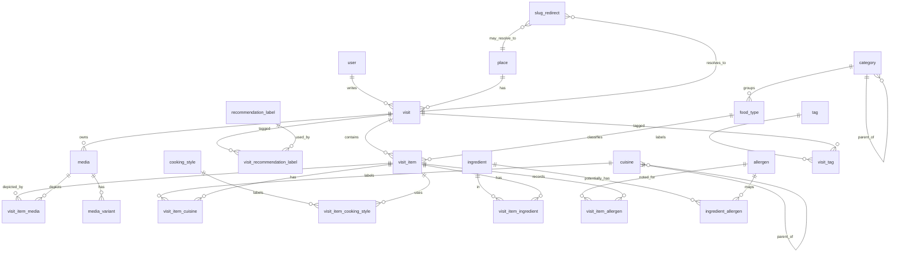

> **Maintained context · 8 November 2026:** Unchanged product/domain rules in this root specification remain authoritative. Original draft proposals, review questions, wireframes and checkboxes are not current implementation claims or new approval blockers. Current experience: [product vision / precedence](docs/product-vision.md), [page contracts](docs/page-experience.md), [art direction](docs/art-direction.md), [motion](docs/motion-interaction.md). Actual status: [baseline audit](docs/implementation-status.md). Historical U1–U10/D1–D7 resolutions: [implementation decisions](docs/implementation-decisions.md#approved-defaults).

# FOODIE — ERD & Database Specification

> **Versi:** Draft v1.1 · **Tanggal:** 4 November 2026 · **Status:** Desain untuk review; bukan migration yang sudah diimplementasi  
> **Terkait:** `product-blueprint.md`, `sitemap.md`, `design-system-specification.md`, `user-flow-wireframe.md`  
> **Stack:** Laravel + MySQL; seluruh **nama tabel singular**, `snake_case`, FK berakhiran `_id`, `id` bigint unsigned; Laravel model wajib menetapkan `$table` ketika nama singular tidak mengikuti konvensi Eloquent.

## 1. Keputusan domain dan batasan

1. **Visit adalah aggregate root pengalaman**; `place` adalah konteks lokasi; item menyimpan identitas menu dan harga saat kunjungan, bukan menu global dengan harga hidup.
2. **`category` != `food_type` != `cuisine` != `cooking_style` != `ingredient` != `allergen` != `tag` != `recommendation_label`.** Cegah checkbox yang artinya berulang.
3. **Food taxonomy** (usulan untuk menghapus redundansi): `category` adalah kelompok hierarkis ringan (*Makanan → Mie*, *Minuman → Kopi*), `food_type` adalah jenis spesifik lintas penjual (*Mie Ayam*, *Kopi Susu*). Jangan membuat category leaf "Mie Ayam" sekaligus food_type "Mie Ayam".
4. **Cuisine** menyatakan tradisi/regional kuliner (*Asia → Thai/Japanese*, *Eropa → Italian*). `Western` bukan negara atau definisi geografis baku; jika dipakai, tandai sebagai istilah editorial luas, **jangan** menganggap semua makanan Italia otomatis `Western` kecuali kebijakan kurasi secara eksplisit demikian. Cuisine melekat pada **item**, bukan otomatis semua hidangan dalam sebuah restoran. Multi-assignment opsional untuk fusion; leluhur tidak perlu disimpan dua kali.
5. **Cooking style** adalah teknik pengolahan multi-tag (*fried*, *grilled*, *boiled*). Satu item dapat diberi lebih dari satu.
6. **Ingredient** adalah bahan yang *diketahui/dicatat*, bukan resep lengkap pasti. **Allergen** adalah penanda potensi bahaya yang **berbeda** dengan bahan dan tidak memberi jaminan keamanan. Unknown tidak pernah otomatis menjadi free-from.
7. `visit_item` boleh memuat nama menu bebas, tetapi disarankan terhubung ke `food_type` terstandardisasi bila cocok. Item dapat berasal dari tempat berbeda dengan snapshot yang tidak berubah.
8. Draft boleh sangat minim; validasi publish ditetapkan terpisah. Rating dan biaya boleh null; status `private` bukan sinonim tidak lengkap.

## 2. Diagram relasi konseptual (Mermaid)



**Catatan diagram:** `slug_redirect` adalah tabel polymorphic atau berisi kolom target sesuai rancangan final; hubungan ke `place` dan `visit` adalah **alternatif**, bukan kedua FK wajib. Bila Laravel morph dipilih, gunakan `entity_type/entity_id` whitelist (bukan type arbitrer dari HTTP).

## 3. Spesifikasi tabel utama

Tipe data bersifat **usulan migration**, bukan perintah menambahkan semuanya sekaligus. Semua tabel yang memiliki metadata standar menggunakan `created_at/updated_at`; `deleted_at` hanya pada entitas yang membutuhkan soft delete.

| Tabel (singular) | Kolom inti | Constraint / indeks penting | Penghapusan / catatan |
|---|---|---|---|
| `user` | `id`, `name`, `email`, `password`, timestamps | `UNIQUE(email)` | Satu pemilik; auth admin. Sesuaikan konfigurasi auth Laravel agar tabel singular. |
| `place` | `id`, `name`, `slug`, `address` nullable, `city_name` nullable, `province_name` nullable, `maps_url` nullable, `latitude/longitude` nullable, timestamps, `deleted_at` | `UNIQUE(slug)`, index `(city_name,id)`, validasi pasangan koordinat dan range | Restrict/hide bila masih punya visit; jangan hapus riwayat secara tak sengaja. |
| `visit` | `id`, `place_id`, `user_id`, `slug`, `title` nullable, `visited_at` nullable, `status`, `experience`, `service_review`, `atmosphere_review`, `cleanliness_review`, `value_review`, `conclusion` nullable, `service_rating`, `atmosphere_rating`, `cleanliness_rating`, `value_rating` nullable, `total_spent_idr` nullable, `cover_media_id` nullable, timestamps, `deleted_at` | `UNIQUE(slug)`; index `(status,visited_at,id)`, `(place_id,status,visited_at)`; FK restrict place; status whitelist | Sumber cerita dan visibility. `title/visited_at` boleh null saat draft awal, publish gate mengatur minimal. |
| `visit_item` | `id`, `visit_id`, `food_type_id` nullable, `menu_name`, `quantity` nullable, `unit_price_idr` nullable, `taste_rating` nullable, `notes` nullable, `sort_order`, timestamps | index `(visit_id,sort_order)`, `(food_type_id,id)`; `CHECK(price >= 0)` bila ada; rating 1–5 step .5 | Item snapshot; delete item bukan menghapus foto bersama. |
| `category` | `id`, `parent_id` nullable, `name`, `slug`, `is_active`, `sort_order` | `UNIQUE(slug)`, FK self; prevent cycle di service | Nonaktifkan kategori yang dipakai, jangan cascade data historis. |
| `food_type` | `id`, `category_id` nullable, `name`, `slug`, `is_active` | `UNIQUE(slug)`, index category | Satu jenis spesifik; tidak sama dengan snapshot menu. |
| `cuisine` | `id`, `parent_id` nullable, `name`, `slug`, `classification` (`region`/`tradition`/`editorial`), `is_active` | `UNIQUE(slug)`; self FK; enforce max depth via application | Gunakan deskripsi untuk label luas seperti *Western*. |
| `cooking_style` | `id`, `name`, `slug`, `is_active` | `UNIQUE(slug)` | Teknik memasak; multi via pivot. |
| `ingredient` | `id`, `name`, `slug`, `is_active` | `UNIQUE(slug)` | Jangan auto-claim resep atau allergen-free. |
| `allergen` | `id`, `code`, `label_id`, `label_en`, `is_active`, `sort_order` | `UNIQUE(code)` | Controlled baseline, nonaktifkan tanpa menghapus historis; seed berdasarkan referensi di §8. |
| `recommendation_label` | `id`, `name`, `slug`, `is_active` | `UNIQUE(slug)` | Label editorial visit, bukan threshold rating. |
| `tag` | `id`, `name`, `slug`, `is_active` | `UNIQUE(slug)` | Editorial tagging. |
| `media` | `id`, `visit_id`, `uuid`, `original_path`, `mime_type`, `original_bytes`, `width`, `height`, `alt_text` nullable, `processing_status`, `sort_order`, timestamps | `UNIQUE(uuid)`, index `(visit_id,sort_order)`; disk privat; MIME sniffed | Original dipertahankan; aset derivative dipisah; lifecycle aman. |
| `media_variant` | `id`, `media_id`, `variant`, `path`, `mime_type`, `width`, `height`, `bytes`, `status` | `UNIQUE(media_id,variant)` | `card`, `thumbnail`, `hero`/`large` bila dibutuhkan; pipeline idempotent. |
| `slug_redirect` | `id`, `entity_type`, `entity_id`, `old_slug`, `created_at` | `UNIQUE(entity_type,old_slug)` | Lookup hanya target publik; cegah chain/loop. |

**Pivot (semua singular):** `visit_item_cuisine(visit_item_id,cuisine_id)`, `visit_item_cooking_style(visit_item_id,cooking_style_id)`, `visit_item_ingredient(visit_item_id,ingredient_id,knowledge_source,notes)`, `visit_item_allergen(visit_item_id,allergen_id,exposure_status,evidence_source,notes)`, `ingredient_allergen(ingredient_id,allergen_id,relation_status,notes)`, `visit_item_media(visit_item_id,media_id)`, `visit_tag(visit_id,tag_id)`, `visit_recommendation_label(visit_id,recommendation_label_id)`. Set **unique composite** atas seluruh pasangan FK; index reverse sesuai filter yang terbukti diperlukan.

**Penting:** `media.visit_id` dan `visit_item.visit_id` harus sama sebelum membuat `visit_item_media` atau men-set `cover_media_id` di `visit`. Tegakkan dalam action dengan transaksi + policy, test negatif; bisa diperketat dengan composite FK bila diperlukan. `visit.cover_media_id` boleh null dan tidak boleh merujuk gambar dari visit lain.

## 4. Snapshot, harga, rating, dan visibilitas

### Harga

- `visit_item.unit_price_idr`: integer non-negatif, per unit pada **kunjungan tersebut**. `quantity` opsional (jika null tampil tanpa angka asumsi). `visit.total_spent_idr`: angka yang dicatat admin sebagai **total pengeluaran kunjungan**, bukan computed column dari item; bisa berbeda karena pajak/ongkir/diskon atau transaksi parsial.
- Jangan menganggap `NULL=0`. Satu item bernilai 0 **valid** bila memang gratis; bukan fallback untuk kosong. Format UI selalu `Rp`, angka IDR tanpa floating point.
- Harga item di tab Food; total di tab Visit; tab Place tidak memakai filter harga MVP.

### Rating

- Semua **input** rating `NULL` atau 1.0–5.0 kelipatan 0.5. Implementasi: kolom `DECIMAL(2,1)` + server validation; optional CHECK seperti `rating IS NULL OR (rating BETWEEN 1 AND 5 AND MOD(rating * 2,1)=0)` untuk MySQL pendukung.
- `taste(visit) = AVG(visit_item.taste_rating WHERE NOT NULL)`; jika tanpa item dinilai, `NULL`.
- `overall(visit) = AVG(non-null [taste,service,atmosphere,cleanliness,value])`; jika semua null, `NULL`. Misal taste 4,0; service 3,5 → overall 3,75 → tampil **3,8**.
- `rating(place) = AVG(overall(visit))` hanya kunjungan published, tidak dihapus, **dan memiliki overall != NULL**. Jumlah yang ditampilkan adalah jumlah **kunjungan dinilai**, bukan jumlah pengguna yang review.
- Jangan bulatkan nilai taste/overall ke 1 desimal di tengah komputasi. Untuk sorting/filter/agregat, hitung dari nilai presisi (query/service) atau materialize presisi tinggi dengan invalidation yang terbukti; satu desimal hanya pada presentation layer.

### Public guard

- Scope eligibility: `visit.status='published' AND visit.deleted_at IS NULL AND place.deleted_at IS NULL`. Turunan item, foto, cuisine, ingredient, allergen, tag, aggregation, metadata, sitemap, dan suggestion semuanya berasal dari eligible source.
- `place` hanya terbuka di publik jika punya sedikitnya satu eligible visit. Privasi bukan flag UI; semua detail route, search, image route, dan preview harus ditegakkan backend.
- **Media URL**: simpan original dan variant di storage privat. Rute pembacaan `GET /media/{uuid}/{variant}` mengecek apakah pemanggil admin yang diizinkan **atau** gambar milik visit published. Setelah unpublish akses baru harus ditolak; salinan yang sudah diunduh/cache ketika published tidak mungkin ditarik kembali sepenuhnya. Cegah penggunaan direktori publik langsung untuk raw path.

## 5. Pipeline media: original + optimized derivative

1. **Upload**: validasi extension *dan* signature/MIME, batas ukuran/pixel count, maksimal jumlah per visit dan izin; gagal parsial ditangani.
2. **Simpan original berkualitas tinggi** di private disk, dengan UUID acak. Jalankan **optimasi konservatif pada original** bila aman (misalnya lossless compression/metadata sanitation) tanpa otomatis downscale; pekerjaan sementara diverifikasi sebelum original resmi diganti. Jika encoding lossless tidak efektif, original tetap dipertahankan dan penghematan utama datang dari derivatives. Hilangkan metadata sensitif (misalnya EXIF GPS) dari keluaran publik.
3. **Derive** minimal: `thumbnail` (~320–480 px), `card` (~640–960 px), dan `hero` (~1280–1920 px) bergantung kebutuhan layout; ukuran adalah *starting point*, ukur dari desain sebenarnya. Gunakan WebP/AVIF bila dukungan encoder tersedia dan fallback sesuai browser/operasi; `srcset/sizes`, width/height, serta crop konsisten.
4. **Navigasi** (Home/Explore/related/gallery thumbnail) memakai variant optimized. **Viewer/lightbox** meminta original melalui URL protected ketika pengunjung memilih perbesar; boleh intermediate large jika original sangat besar tetapi akses original harus tersedia dan kualitas tetap terjaga.
5. **Memproses**: status `pending/processing/ready/failed`; worker/queue bila tersedia, fallback sederhana terkontrol bila environment belum punya worker. Tombol retry untuk admin. Jangan tampil broken image dan jangan menghapus original saat derivative gagal.
6. **Cover** hanya ID referensi ke `media` milik visit; cover, galeri, relasi item tidak membuat duplikat fisik. Delete physical setelah semua relasi aman & retention/trash policy terencana. Cleanup orphan dan backup DB+media konsisten.
7. **Kecepatan**: hero LCP prioritas, jangan `loading="lazy"` pada LCP; gambar bawah viewport lazy; `decoding="async"` bila membantu, preload/fetchpriority hanya satu hero benar-benar kritis. Evaluasi metrik LCP/CLS, beban storage dan CPU.

## 6. Slug, default value, dan convenience admin

| Field | Perilaku default | Bisa diedit? | Catatan backend |
|---|---|---|---|
| `place.slug`, `visit.slug`, semua taxonomy slug | Otomatis dari name/title; suffix jika berbenturan | Ya | Slug manual divalidasi uniqueness; setelah user edit **tidak ditimpa** oleh auto-generate. Edit nama existing tidak mengubah slug otomatis. |
| `visit.visited_at` | Waktu lokal Asia/Jakarta saat membuka form | Ya | Default hanya pada form baru; hindari menyetel ulang ketika validation error/refresh/edit. Simpan representasi waktu konsisten dan test boundary timezone. |
| `visit.status` | `draft` | Ya, lewat publish flow | Tidak auto-publish hanya karena field lengkap. |
| `visit_item.quantity` | `1` pada UI item baru | Ya / boleh kosong jika tidak relevan | Jangan otomatis mengubah item historis. |
| Lokasi/ingredient/cuisine/style | Search-select / chips dari master | Ya, pilih/inline-create bila diizinkan | Search berbasis server untuk list panjang, debounce, keyboard, deteksi duplikat. |
| `media.alt_text` | Saran teks dari nama item/visit **untuk direview** | Ya | Jangan mengarang isi visual sebagai fakta; field dekoratif boleh alt kosong yang disengaja. |
| Rating/biaya/bahan/alergen | **Kosong** | Ya | Jangan mengarang default yang tampak seperti fakta. |

- Backend tetap menghitung ulang dan memvalidasi slug; `firstOrCreate` tak cukup untuk concurrency tanpa unique + error retry; transaksi untuk pembuatan terkait.
- Bila slug published diubah manual, buat redirect 301 terkontrol dan uji tabrakan; jangan redirect private slug ke data tidak eligible.
- Saat pilih place, tampilkan kandidat duplikat (normalized name + area), bukan otomatis menggabungkan data.

## 7. Query, index, relasi Eloquent, dan migration safety

**Kueri dominan:** Explore Visit `status/visited_at`, Food `(visit status → item → tags/taxonomy)`, Place published visit aggregates; pencarian `city`, `cuisine`, `style`, `ingredient`, `allergen`. Prefetch relasi tempat, cover+variant, item count/rating dengan eager load & pagination; jangan N+1.

**Filter alergen (bukan sertifikat aman):**

- Status informasi per item: `contains` (tercatat mengandung), `may_contain` (risiko/keterangan kontaminasi silang), **unknown** (tidak ada catatan). `unknown` adalah **ketiadaan record**, bukan kategori `free`.
- Default mode 'Hindari yang **tercatat** mengandung/berpotensi mengandung X' mengecualikan `contains` dan `may_contain`, tetapi **tetap dapat menampilkan unknown** dengan badge **Informasi belum tersedia** + disclaimer menonjol. Jangan beri nama "aman untuk alergi X".
- Opsi strict `Hanya yang telah diverifikasi bebas X` **tidak tersedia pada MVP**: untuk bisa ada memerlukan bukti absence, sumber verifikasi, expiry, dan aturan cross-contact yang jauh lebih serius.
- `ingredient_allergen` adalah **referensi bantuan admin**, bukan deduksi final bahwa sebuah menu aman/tidak aman. Admin bisa menerima penanda 'possible/contains' saat sumber mendukung; jika tidak pasti, catat unknown. Jangan hasilkan klaim dari foto/menu name/model AI.
- Di UI, label "Gandum" dan "Serealia mengandung gluten" tidak saling dipertukarkan. Alergi gandum, penyakit celiac dan intoleransi gluten bukan konsep yang identik; `cereals_gluten` adalah **kelompok pelabelan EU**, terdiri antara lain wheat/rye/barley/oats. Implementasi filter grup perlu memetakan kunci terperinci, bukan menganggap semua jenis reaksi sama.

**Indeks sebelum optimasi:** FK dan unique dahulu; `(status,visited_at,id)`, `(place_id,status,visited_at,id)`; item `(visit_id,sort_order)`, pivot unique pasangan dan reverse index bila digunakan; hindari index pada semua kolom tanpa melihat `EXPLAIN`. Untuk `q`, mulai LIKE yang dibatasi; bila volume menuntut, pertimbangkan FULLTEXT setelah verifikasi bahasa dan UX.

**Transaksi:** `create/edit visit + item/pivot + cover selection`, `publish/unpublish + cache invalidation event`, `slug switch + redirect`; file IO bukan transaksi DB — gunakan staged upload/finalize/compensating cleanup dan idempotent job.

**Delete:** Soft-delete visit/place (jika diputuskan), restrict master yang digunakan, pivot cascade hanya saat owner memang dihapus, original file tidak dihapus sebelum ref count/lifecycle aman. Foreign key yang nullable tetap harus didokumentasikan perilakunya (`SET NULL` atau `RESTRICT`).

## 8. Alergen: seed awal, riset 2021–2026, dan keterbatasan

Referensi regulasi **FDA AS: sembilan kelompok** (susu, telur, ikan, krustasea, kacang pohon, kacang tanah, gandum, kedelai, wijen). Referensi pelabelan **Uni Eropa: 14 kategori** (serealia mengandung gluten; krustasea; telur; ikan; kacang tanah; kedelai; susu; kacang pohon; seledri; mustard; wijen; sulfur dioksida/sulfit di atas ambang regulasi; lupin; moluska). Dua daftar *bukan* pemetaan satu banding satu karena AS menggunakan kategori **wheat** sedangkan EU menggunakan kelompok **gluten-containing cereals**. Jangan menganggap semua bahan berisiko telah dicakup: terdapat alergen lain di luar kedua daftar.

**Kunci `allergen` kandidat:** `milk`, `egg`, `fish`, `crustacean`, `tree_nut`, `peanut`, `wheat`, `soy`, `sesame`, `celery`, `mustard`, `sulphite`, `lupin`, `mollusc`, `rye`, `barley`, `oat`. Tampilan grup "serealia mengandung gluten" menggabungkan yang relevan, dengan catatan pengolahan dan regulasi. Untuk makanan Indonesia, bantu pengisian alias `udang`, `terasi` (bergantung komposisi), `kecap` (periksa bahan), `susu`, `telur`, tetapi **jangan tetapkan alergen berdasar nama umum tanpa informasi komposisi**.

**Kebijakan keselamatan:** alergi dapat berbahaya; Foodie adalah catatan observasi satu orang, bukan pengujian laboratorium atau label resmi penjual. Data dapat salah/tidak lengkap, resep berubah, dan kontaminasi silang mungkin terjadi. Keterangan per item: sumber (`menu_label`, `owner_statement`, `observed_ingredient`, `inference_reviewed`) dan tanggal observasi pada konteks visit; tampilkan sumber secara ringkas bila ada. Tulis “Bahan/alergen yang dicatat, bukan jaminan bebas alergen”; pengunjung dengan alergi sebaiknya memverifikasi langsung ke penjual dan mengikuti arahan tenaga kesehatan. Jangan memberi advice diagnosis.

**Rujukan ilmiah/otoritas terbaru (diakses 4 November 2026):**

- European Commission, **Allergies / 14 allergens**, Feb 2026: https://food.ec.europa.eu/food-safety/campaign-2026/allergies_en
- FDA, **Food Allergies: What You Need to Know** (pembaruan tentang 9 major allergens dan sesame efektif 2023): https://www.fda.gov/food/buy-store-serve-safe-food/food-allergies-what-you-need-know
- FDA, **Questions and Answers Regarding Food Allergens, Edition 5**, Jan 2025: https://www.hhs.gov/guidance/sites/default/files/hhs-guidance-documents/FDA/FDA-Guidance-Jan2025-AllergenLabelingQA-12292024.pdf
- Santos et al., **EAACI guidelines on diagnosis of IgE-mediated food allergy**, *Allergy*, 2023, DOI 10.1111/all.15902: https://pubmed.ncbi.nlm.nih.gov/37815205/
- Santos et al., **EAACI guidelines on management of IgE-mediated food allergy**, *Allergy*, first online 2024 / issue 2025, DOI 10.1111/all.16345: https://pmc.ncbi.nlm.nih.gov/articles/PMC11724237/

Sumber klinis menunjukkan risiko dapat berat dan penghindaran alergen yang telah terdiagnosis membutuhkan informasi yang dapat dipercaya. Tidak ada data di sini yang membenarkan klaim keamanan makanan hanya karena bahan belum dicatat.

## 9. Query examples (pseudo Eloquent, bukan code production)

```php
// Seluruh public query menggunakan scope central yang sama.
Visit::query()
    ->publishedVisible()                 // status published + non-deleted + place eligible
    ->with(['place', 'coverMedia.variants'])
    ->orderByDesc('visited_at')
    ->orderByDesc('id')
    ->paginate(18)->withQueryString();

// Food price filter menggunakan snapshot item, bukan visit.total_spent_idr.
VisitItem::query()
    ->whereHas('visit', fn ($q) => $q->publishedVisible())
    ->when($minPrice !== null, fn ($q) => $q->where('unit_price_idr', '>=', $minPrice));

// Filter "hindari yang tercatat mengandung": UNKNOWN tetap ada dan harus berlabel.
VisitItem::query()->whereDoesntHave('allergenEvidence', function ($q) use ($selectedIds) {
    $q->whereIn('allergen_id', $selectedIds)
      ->whereIn('exposure_status', ['contains', 'may_contain']);
});
```

## 10. QA dan keputusan terbuka sebelum migration

**Must-test:** place dengan 0 eligible visit; same place many visit; publikasi/unpublish; no private image route; cross-visit media tampering; slug duplicate/rename, collision dan back navigation; null vs 0; precision rating; rating 0.5 invalid/missing; item vs visit prices; multi cuisine/style; ingredient unknown; filter allergen excludes known, flags unknown; retry derivative; EXIF; orphan cleanup; timezone tanggal; concurrent form submission; backup/restore.

**Keputusan untuk review:** (D1) `category` groups + `food_type` specific seperti §1; (D2) cuisine multi-tag per item dengan parent opsional; (D3) no strict allergy-safe filter MVP; (D4) original hanya diakses melalui media controller walau published; (D5) visited_at apakah perlu jam (rekomendasi ya, tetapi opsional untuk draft); (D6) deletion gunakan soft-delete dan explicit admin confirmation; (D7) field `quantity` default 1 dan harga nullable.

**Tidak boleh ditafsirkan sebagai:** repo telah diinspeksi, schema telah di-migrate, referensi hukum Indonesia, label sertifikasi alergi, atau benchmark performa yang telah dijalankan.
