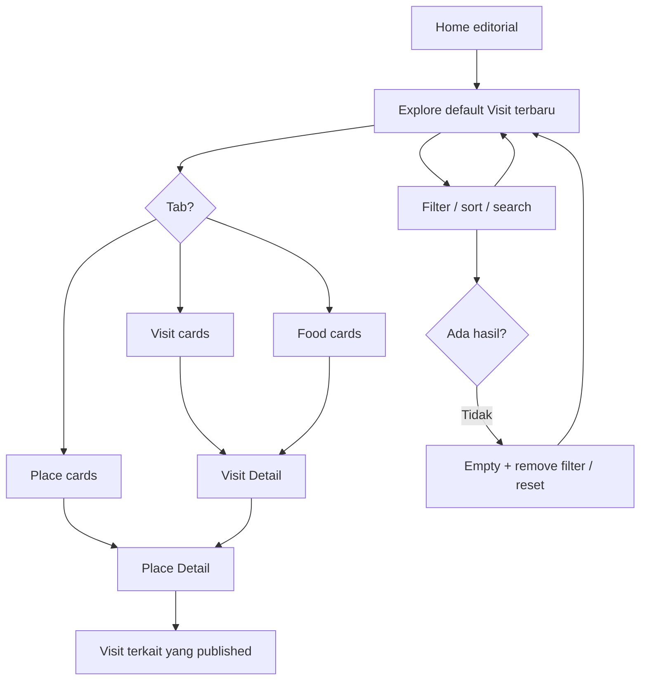
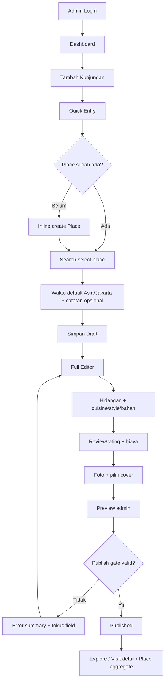

# FOODIE — User Flow & Low-Fidelity Wireframe

> **Versi:** Draft v1.1 · **Tanggal:** 4 November 2026 · **Status:** Wireframe tekstual untuk review (bukan high-fidelity visual, bukan Blade/UI yang sudah dikerjakan)  
> **Acuan:** `product-blueprint.md`, `sitemap.md`, `erd-database-specification.md`, `design-system-specification.md`

## 1. Goal setiap perjalanan

**Pembaca kasual:** menemukan pengalaman menarik dengan **sedikit keputusan**. **Pembaca detail:** membandingkan food/visit/place dengan price dan rating semantik benar. **Admin:** membuat draft 30–60 detik sebagai target UX yang **akan diuji, bukan benchmark yang sudah dibuktikan**, lalu melanjutkan full editor tanpa mengulang input. **Semua:** tidak ada misleading allergen-safe claims.

**Prinsip interaksi:** 1 aksi dominan per scene; ajakan navigasi konteks spesifik; jangan menambah CTA yang mengulang seluruh card clickable; situs publik tanpa login/registrasi; admin auth terproteksi.

## 2. Journey maps

### 2.1 Publik — mulai dari pengalaman



**Definition of done:** Pembaca dari Home dapat menemukan minimal satu published visit dengan maksimal satu CTA eksplorasi; dalam hasil bisa membedakan harga item dan total visit; pindah tab + browser Back/Forward tidak kehilangan filter yang kompatibel.

### 2.2 Admin — catat cepat, lengkapi nanti



**Prinsip**: Semua step dapat disimpan sebagai draft. `private` juga dapat dipilih tanpa publish. Status tidak pernah berubah otomatis hanya karena form lengkap. Preview `/admin/visit/{id}/preview`, bukan query `?preview=1` publik.

### 2.3 Fitur bahan/alergen — disclosure bertanggung jawab

```mermaid
flowchart TD
    A[Explore advanced: Informasi bahan dan alergen] --> B[Pilih alergen yang ingin dihindari]
    B --> C[Disclose: "hanya sembunyikan yang tercatat"]
    C --> D[Server exclude contains dan may_contain]
    D --> E[Hasil tersisa, mungkin unknown]
    E --> F[Card/detail: tampilkan status informasi yang ada]
    F --> G[Anjuran verifikasi langsung ke penjual]
```

Jangan ada state `safe for allergies` tanpa program verifikasi yang sangat berbeda dari jurnal kuliner. Kasus **unknown** tidak diperlakukan sebagai **verified absent**.

## 3. Sitemap UX dan arah navigasi

```text
PUBLIC
  Home (/)                                  [Home hero + story]
    Explore (/explore)                      [Visit / Food / Place]
      Visit Detail (/visit/{slug})          [Experience + item + gallery]
        Place Detail (/place/{slug})        [Identity + timeline visits]
      Filter shortcuts (/explore?...)
    About (/about)                          [P1]
    Curated landing (/city|category|food|cuisine|style|recommendation/{slug}) [P1]

ADMIN (auth + authorization)
  Login (/admin/login)
  Dashboard (/admin)
    Visit list (/admin/visit)
      Quick Entry (/admin/visit/create)
      Full Editor (/admin/visit/{id}/edit)
      Preview (/admin/visit/{id}/preview)
    Place (/admin/place)
    Taxonomy Hub (/admin/taxonomy)
      Category, Food Type, Cuisine, Cooking Style, Ingredient,
      Allergen (controlled list), Tag, Recommendation
    Media maintenance (/admin/media) [P1]
    Settings (/admin/settings) [P1]

MEDIA GET (/media/{uuid}/{variant}) — authorized per current visit visibility
```

## 4. Wireframe publik — desktop

**Legenda:** `[ ]` area/kontrol; `( )` metadata; `====` image placeholder *wireframe saja*, **bukan** garis dekorasi yang harus dibuat di UI. Ukuran, foto, font, dan warna high-fidelity dibahas pada desain lanjutan.

### 4.1 Home desktop (1440px representative)

```text
┌────────────────────────────────────────────────────────────────────────────┐
│ FOODIE                           Jelajah     [Cari pengalaman...]      ◯  │
│                                                                            │
│ [FEATURED PHOTO HERO / cinematic crop]  |  CATATAN DARI SEBUAH KUNJUNGAN  │
│                                          |  Judul editorial, lokasi, waktu │
│                                          |  Ringkasan singkat, meaningful │
│                                          |  [Jelajahi pengalaman]         │
│                                                                            │
│  Kunjungan terbaru                    [Lihat semua di Explore]             │
│  ┌───────────────────────┐ ┌───────────────────┐ ┌───────────────────┐     │
│  │ PHOTO optimized       │ │ PHOTO optimized   │ │ PHOTO optimized   │     │
│  │ Judul + tempat        │ │ Judul + tempat    │ │ Judul + tempat    │     │
│  │ Tanggal + overall     │ │ Tanggal + overall │ │ Tanggal + overall │     │
│  └───────────────────────┘ └───────────────────┘ └───────────────────┘     │
│                                                                            │
│  Pilihan pribadi / Must Try    [Featured recommendation]                  │
│  Jelajah berdasarkan kota / jenis makanan (links ke Explore filters)      │
│                                                                            │
│ FOOTER: Foodie · Jelajah · Tentang · Rating adalah opini penulis           │
└────────────────────────────────────────────────────────────────────────────┘
```

**Konten**: Hanya published. Featured fallback bila kosong, hero photo optimized untuk LCP; card photos lazy bila below fold. **Jangan** memasukkan divider horizontal antar section; gunakan white space besar dan hierarki heading. Jika semua konten published kosong, editorial empty state (bukan section kosong/kartu palsu).

### 4.2 Explore desktop — progressive filters

```text
┌────────────────────────────────────────────────────────────────────────────┐
│ FOODIE  Jelajah                                   [Cari...            ]   │
│                                                                            │
│ Jelajahi cerita makanan                                                   │
│ [ Visit ] [ Food ] [ Place ]          (jumlah hasil)     [Grid|List]      │
│                                                                            │
│ [Kota v] [Jenis hidangan v] [Rating v]  [Semua filter (2)] [Urutkan v]    │
│ [Kota: Semarang ×] [Teknik: Grilled ×]                      [Hapus semua] │
│                                                                            │
│ ┌──────────────────┐  ┌─────────────────┐ ┌─────────────────┐             │
│ │ PHOTO optimized  │  │ PHOTO optimized │ │ PHOTO optimized │             │
│ │ Visit title      │  │ Visit title     │ │ Visit title     │             │
│ │ Place · date     │  │ Place · date    │ │ Place · date    │             │
│ │ Overall 4.2      │  │ Belum Dinilai   │ │ Overall 3.9     │             │
│ │ Total Rp45.000   │  │ Total -         │ │ Total Rp60.000  │             │
│ └──────────────────┘  └─────────────────┘ └─────────────────┘             │
│ Pagination (URL preserves filters)                                        │
└────────────────────────────────────────────────────────────────────────────┘
```

**Tab behavior**:

- Visit = total pengeluaran + overall rating.
- Food = **harga unit item snapshot** + taste rating; card menaut ke Visit Detail; informasi place terlihat di kartu.
- Place = rating rata-rata (berapa visit dinilai) dan latest visit; **tanpa** filter harga umum MVP.
- Option label memberi tahu jika query item-level diterapkan pada Visit/Place (`setidaknya satu hidangan yang cocok`).
- Tidak ada hasil: *“Belum ada pengalaman yang cocok dengan pilihan ini.”* + `Hapus filter` dan chips tetap accessible; jangan hapus q secara mendadak.

### 4.3 Panel advanced filter desktop

```text
┌──────────────────────────────────────────────────┐
│ Filter lengkap                              [×]  │
│ Lokasi             [Kota (searchable)      v]    │
│ Makanan            [Jenis (searchable)     v]    │
│                    [Kategori             v]     │
│ Tradisi kuliner    [Thai □] [Italian □] [...]   │
│ Teknik memasak     [Goreng □] [Bakar □] [...]   │
│ Budget dan rating  [Min       ] [Max      ]      │
│ Bahan diketahui    [Cari bahan...            ]   │
│ Alergen            [Pilih yang dihindari...   ]  │
│   (!) Hanya menyembunyikan makanan yang tercatat  │
│       mengandung/berpotensi; unknown masih muncul│
│ Label/editorial    [Must Try □] [Hidden Gem □]   │
│                                                  │
│ [Reset filter]         [Tampilkan 18 hasil]       │
└──────────────────────────────────────────────────┘
```

**Desain final tidak wajib menggunakan garis frame** seperti ASCII; panel punya group header, whitespace dan separator hanya jika perlu. Jangan sajikan 14+ allergen checkboxes secara permanen di luar panel.

### 4.4 Visit Detail desktop

```text
┌────────────────────────────────────────────────────────────────────────────┐
│ Header / Breadcrumb                                                       │
│ HERO PHOTO optimized (large)                 Tanggal · Kota · Tempat       │
│                                             JUDUL KUNJUNGAN              │
│                                             Overall 4.3 / Belum Dinilai │
│                                                                            │
│ CERITA KUNJUNGAN (body editorial, 60–75 chars per line)                   │
│                                                                            │
│ HIDANGAN YANG DICOBA                                                      │
│  [thumbnail] Mie Ayam — Rp25.000 | Taste 4.5 | Thai? / Boiled              │
│  [thumbnail] Es Teh — Rp8.000   | Taste -   | Bahan diketahui: ...          │
│                                                                            │
│ TOTAL PENGELUARAN KUNJUNGAN: Rp36.000                                      │
│ ULASAN TERSTRUKTUR (tampilkan hanya field yang diisi)                     │
│ GALERI (thumbnails optimized) → click opens protected original viewer     │
│ ALERGEN: label status per hidangan, tidak menjanjikan aman                │
│ KESIMPULAN / rekomendasi (bila ada)                                        │
│ [Lihat tempat]   [Buka Google Maps bila tersedia]                         │
└────────────────────────────────────────────────────────────────────────────┘
```

**Note:** Jangan menampilkan cuisine contoh "Thai?" sebagai tebakan di production; dalam wireframe ini hanya placeholder untuk metadata opsional. Section kosong dihilangkan. Modal foto menampilkan original dan bisa ditutup keyboard.

### 4.5 Place Detail desktop

```text
┌────────────────────────────────────────────────────────────────────────────┐
│ Foto unggulan published visit (bila ada)   NAMA TEMPAT                    │
│                                          Semarang / alamat opsional       │
│                                          [Buka Google Maps] bila valid     │
│                                                                            │
│ Rata-rata rating: 4.1 dari 3 kunjungan dinilai                            │
│ RIWAYAT KUNJUNGAN                                                         │
│  [visit thumbnail] 04 Nov 2026  Overall 4.0 — Visit detail                │
│  [visit thumbnail] 12 Aug 2026  Overall 4.3 — Visit detail                │
│  [visit thumbnail] 17 Apr 2026  Belum Dinilai — Visit detail              │
│                                                                            │
│ Hidangan yang pernah dicoba (semua snapshot diberi tanggal)               │
└────────────────────────────────────────────────────────────────────────────┘
```

Tanggal dalam wireframe hanya ilustrasi placeholder dan **bukan** data aktual. Tempat tanpa published visit menghasilkan 404 untuk publik sesuai keputusan kerja.

## 5. Wireframe publik — mobile

### 5.1 Explore 375px

```text
┌────────────────────────────┐
│ FOODIE          [Search] ☰ │
│ Jelajah                     │
│ [ Visit | Food | Place ]    │
│ [Cari kuliner...........]   │
│ [Filter (3)] [Urutkan v]    │
│ [Thai ×] [Semarang ×]       │
│ 18 hasil      [Grid | List] │
│ ┌────────────────────────┐ │
│ │     PHOTO optimized    │ │
│ │ Kunjungan / nama place │ │
│ │ Overall • total        │ │
│ └────────────────────────┘ │
│ ┌────────────────────────┐ │
│ │     PHOTO optimized    │ │
│ │ ...                    │ │
│ └────────────────────────┘ │
└────────────────────────────┘
```

### 5.2 Filter sheet 375px

```text
┌────────────────────────────┐
│ Filter                 [×] │
│ [Cari pilihan filter...]   │
│ Lokasi                  v   │
│ Jenis hidangan          v   │
│ Asal/tradisi kuliner    v   │
│ Teknik memasak          v   │
│ Harga & rating          v   │
│ Bahan & alergen         v   │
│ Rekomendasi             v   │
│                            │
│ [Reset semua]              │
│ [Tampilkan 18 hasil]       │
└────────────────────────────┘
```

Sheet: dim overlay, focus trap/restore, Escape, close, sticky actions, lock scrolling page, valid applied URL when submit; preserve draft filter while sheet open dan cancel discard draft, jangan silently apply. If zero matches, tombol tetap bisa `Tampilkan 0 hasil` atau menyediakan remove filters; tidak memblokir keluar.

## 6. Wireframe Admin — Quick Entry & Full Editor

### 6.1 Quick Entry desktop

```text
┌────────────────────────────────────────────────────────────────────────────┐
│ Admin / Dashboard      [Kembali ke kunjungan]                             │
│ Tambah kunjungan baru                                                     │
│                                                                            │
│ TEMPAT                                                                     │
│ [Cari tempat / warung / kota ...                                 v]       │
│   Suggestions: Warung Mie A (Semarang), ...                               │
│   + Tambah tempat baru (inline dialog; no form loss)                      │
│ TANGGAL & WAKTU                                                           │
│ [04-11-2026] [10:34] (default Asia/Jakarta; editable)                     │
│ CATATAN SINGKAT (opsional)                                                │
│ [Apa yang menarik dari kunjungan ini?............................]        │
│ STATUS: Draft (default)                                                   │
│                                                                            │
│ [Batal]                         [Simpan draft]                             │
└────────────────────────────────────────────────────────────────────────────┘
```

**No slug field mandatory**. Slug visit dibangkitkan dari title jika ada, atau `place + date + unique suffix` sebagai fallback; preview URL editable di Full Editor disclosure. Place inline dialog `name` mandatory, alamat/kota optional; automatic slug; duplicate alert jika mirip. `Simpan draft` tidak membutuhkan item, review, foto, atau rating.

### 6.2 Full Editor desktop

```text
┌────────────────────────────────────────────────────────────────────────────┐
│ Admin / Visit #128              [Saved as Draft]  [Preview] [Publish]     │
│                                                                            │
│  Dasar   Hidangan   Ulasan   Foto   Pratinjau                              │
│                                                                            │
│ HIDANGAN                                                                   │
│ [1] Mie Ayam Bakso                    (Rasa 4.5)             [Expand v]  │
│     Nama menu [______________]  Jenis [Cari... v]                        │
│     Quantity [1] Harga satuan [Rp_______]                                │
│     Asal/tradisi kuliner [Thai?] (searchable; bisa kosong)               │
│     Teknik masak [Boiled ×] [+ tambah] (multi)                            │
│     Bahan diketahui [Mie ×] [Ayam ×] [+ tambah]                            │
│     Alergen teramati [wheat: contains] [source: menu label]               │
│     [Hubungkan foto...] [Catatan / rasa]                                  │
│ [2] Es Teh                              (Belum Dinilai) [Expand v]        │
│ [Tambah hidangan]                                                         │
│                                                                            │
│ [Simpan draft]                  [Lanjut ke Ulasan]                         │
└────────────────────────────────────────────────────────────────────────────┘
```

**Catatan:** `Thai?` di wireframe adalah contoh opsi kosong/placeholder, bukan default atau hasil inferensi otomatis. Semua taxonomy autocomplete memiliki affordance create-new terkontrol, tanpa kehilangan input item yang sedang ditulis. Bahan/alergen disajikan di expandable `Bahan & informasi alergen (opsional)` agar form utama tidak sesak.

### 6.3 Admin mobile

```text
┌────────────────────────────┐
│ Admin     Visit Draft #128  │
│ [Dasar v]  step 2 dari 5    │
│ Hidangan                   │
│ [Nama menu............]    │
│ [Jenis: Cari............]  │
│ [Qty: 1] [Harga: Rp.....]  │
│ [Rasa: Belum Dinilai v]    │
│ [Bahan & alergi (opsi) v] │
│ [Foto (opsi) v]            │
│ [Tambah hidangan]          │
│                            │
│ [Simpan draft]             │
│ [Lanjut]                   │
└────────────────────────────┘
```

Di layar sempit, aksi sama prioritas menggunakan tinggi/min-width sama dan dapat full-width; jangan biarkan teks tombol membuat ukuran acak.

## 7. Interaksi kritis: keputusan, error, restore

| Interaksi | Normal | Edge/failure | Recovery |
|---|---|---|---|
| Search place admin | Suggestions + recent, searchable | 0 match / duplicate / network down | `Tambah baru`, retry, tampil alternatif; tidak hapus form. |
| Auto slug | preview dari nama baru | duplicate; manual edited | suffix deterministik; invalid help; manual lock. |
| Create taxonomy inline | modal → save → selected | duplicate / validation fail | tampil kandidat & perbaikan inline; kembali ke editor dengan state retained. |
| Add/edit item | item card + tags/chips | save gagal, rating invalid | error summary + focus; keep data di form. |
| Media upload | preview original; process derivatives | unsupported, huge, encoder down, crop issue | retry derivative, original jangan terhapus; admin status. |
| Change cover | use existing gallery asset | media beda visit | backend 422; jangan silently use cross-visit. |
| Preview visit | route admin protected | belum ada item/foto | preview fallback, tidak publish otomatis. |
| Publish | validate → transition | race/double click, incomplete | single submission, focus invalid, keep draft, error inline. |
| Unpublish | confirm consequence | cache/derived stale | invalidate, deny new media requests, SEO sitemap update. |
| Explore filter | chips+results update, URL persists | 0 result, unsupported filter on tab, stale AJAX | reset one/all, correct defaults, race guard. |
| Allergy filter | exclude known contains/may contain | records unknown | prominently label unknown + disclaimer, no 'safe' claim. |
| Photo viewer | click optimized thumbnail → fetch original | image missing/revoked/slow | fallback, retry, close with focus restore. |

## 8. Content-first and responsive acceptance

**Copywriting**: Judul punya arti; teks keterangan singkat tentang fakta kunjungan; jangan menambah filler. Metadata (kota, tanggal, harga, rating, label) dikelompokkan, jangan dicampur di semua pojok kartu. Empty states mengganti komponen hilang, bukan mempertahankan frame kosong. Foto dominan dengan aspect ratio konsisten dan crop terkendali. Hero full-bleed optional jika tidak mengorbankan readability; jangan gradient dekoratif.

**Responsive scenarios**: HP kecil, font besar, data menu panjang, slug panjang, nama tempat 80 karakter, filter aktif >8, foto portrait/landscape, belum ada foto, mixed quantity/price unknown, invalid date, kunjungan dengan banyak item, tidak ada tag/ingredient, galleries banyak. Uji keyboard-only dan touch tanpa hover.

## 9. UAT scenarios untuk disetujui sebelum Codex (#5)

1. Admin login → tambah visit hanya pilih place + default time → simpan draft → berhasil tanpa mengisi slug.
2. Buat place langsung dari autocomplete, kembali ke editor tanpa kehilangan draft; peringatan duplicate masuk akal.
3. Nama/title diubah: slug baru otomatis selama belum manual override; setelah manual diedit tetap terkunci; slug published tidak berubah tanpa aksi sadar dan redirect.
4. Dua hidangan: satu punya fried+grilled, Thai cuisine, ingredient; lainnya tidak diisi; Filter Food memunculkan yang cocok saja.
5. Allergen marked contains + may_contain + unknown: filter mengeluarkan dua yang pertama dan **memberi label** unknown; tidak pernah ada klaim aman.
6. Original foto dipakai viewer, derivative dipakai card, cover tidak duplicate, unpublish menolak media request baru.
7. Visit total Rp60.000 vs item Rp25.000: sorting/filter dan display beda semantik; place tanpa filter harga MVP.
8. Search/filter switching Visit/Food/Place menjaga opsi cocok, menghapus price filter ambigu dengan penjelasan; browser Back/Forward konsisten.
9. Rating taste/overall/place pada null dan 0.5 dihitung presisi; published unrated tampil “Belum Dinilai”.
10. Dialog, autocomplete, alerts, toast, reduced motion, keyboard, touch & HTTP errors lolos review WCAG target.
11. Admin tidak bisa mempublikasikan visit invalid, preview protected, private tak muncul di SEO/cards/filter suggestions/media.
12. Visual review terhadap AI-slop: tidak ada unnecessary gradient/divider, action-group button konsisten, hero/card hierarchy tidak seperti template generik.

## 10. Review questions (bukan blocker untuk membaca dokumen)

- Apakah tab Visit/Food/Place dan filter hierarki sesuai cara pengunjung Indonesia mencari ide makan?
- Apakah filter “informasi bahan & alergen” layak tampil sejak P0 sebagai **penanda informasional**, bukan fitur rekomendasi aman?
- Apakah admin lebih nyaman stepper 5 bagian atau satu halaman editor dengan accordion? Fondasi data/component **tetap sama** sehingga bisa diubah tanpa migration.
- Apakah penjelasan “Thai / Italian / Western” sudah tepat sebagai tradisi kuliner non-eksklusif?
- Apakah Place detail harus menampilkan item dari seluruh kunjungan (dengan tanggal historis), atau cukup timeline Visit pada MVP?

**Hasil wireframe ini merupakan sketsa fungsional**. Layout akhir harus diuji memakai foto dan konten kuliner nyata, bukan placeholder semata.
